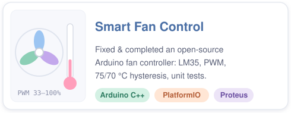
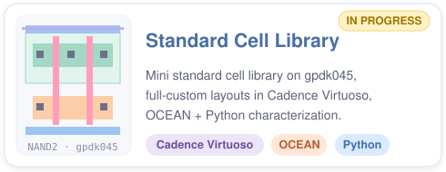

  

  
  
  

## 👨‍💻 About me

- 🎓 IC Design student at **FPT University**, Ho Chi Minh City, Vietnam
- 🔬 Interested in **RTL design & verification** and **physical design / layout**
- 🔧 Currently building a **mini standard cell library** on the gpdk045 (45 nm) PDK in Cadence Virtuoso
- 📡 Built a bit-exact **MATLAB ↔ Verilog** AWGN noise generator for FPGA
- 💼 Connect with me on [LinkedIn](https://www.linkedin.com/in/tu%C3%A2n-nguy%E1%BB%85n-ph%E1%BA%A1m-1782a43b8/) · 📄 [My CV (PDF)](https://github.com/binmotdenchin-jpg/binmotdenchin-jpg/blob/main/CV_NguyenPhamTuan.pdf)

## 🚀 Featured projects

  
  

  

## 🛠️ Tools

  
  
  
  
  
  
  
  

  

